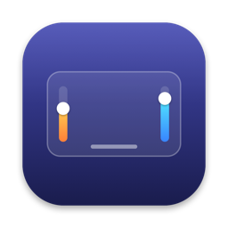
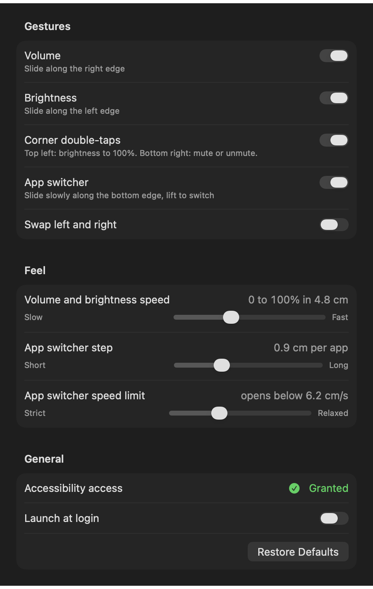

<p align="center"></p>

# NordvaMacEdge

**Turn the edges of your MacBook trackpad into volume and brightness sliders.**

NordvaMacEdge is a tiny, free menu bar app for macOS. Slide a finger along the right
edge of the trackpad to change the volume, along the left edge to change the screen
brightness. Double-tap a corner for quick actions, or slide slowly along the bottom
edge to switch apps. No reaching for the keyboard or Control Center - your hand stays
on the trackpad.

## Install

Works on any MacBook with macOS 13 Ventura or later, Apple Silicon or Intel. No coding needed.

1. **Download** `NordvaMacEdge.zip` from the [latest release](https://github.com/orhan17/NordvaMacEdge/releases/latest).
2. **Unzip** it (double-click the file in Downloads) and **drag `NordvaMacEdge.app` into Applications**.
3. **Open it.** The first time, macOS says it could not verify the app: the app is free and
   not registered with Apple, which costs developers $99 a year. Click **Done**, then go to
   **System Settings → Privacy & Security**, scroll down and click **Open Anyway** next to
   NordvaMacEdge, and confirm with your password or Touch ID. This is needed only once.
4. **Allow access.** A slider icon appears in the menu bar at the top of the screen, and macOS
   asks for Accessibility access. Click **Open System Settings** and turn **NordvaMacEdge** on.
   This powers the app switcher and stops corner taps from also clicking; volume and
   brightness work even without it.
5. **Optional:** click the slider icon in the menu bar, choose **Settings…** and turn on **Launch at login**.

That's it - slide a finger along the right edge of the trackpad and the volume follows.

If macOS says the app "is damaged and can't be opened", open Terminal and run
`xattr -dr com.apple.quarantine /Applications/NordvaMacEdge.app`, then open the app again.

If NordvaMacEdge is switched on under Accessibility but the app switcher still does nothing
(this happens after updating from an older version), select NordvaMacEdge in that list,
remove it with the **−** button, then choose **Allow Access for App Switcher and Corners…**
in the menu and switch it on again.

**To uninstall:** click the slider icon → **Quit NordvaMacEdge**, then move NordvaMacEdge from Applications to the Trash.

## Settings

Click the slider icon in the menu bar → **Settings…** (or press ⌘, while the menu is open).
Turn each gesture on or off, swap the sides, switch the haptic clicks off, and tune how it
feels: how far to slide for the full volume range, how far per app in the switcher and how
slow the switcher slide must be.
Distances are shown in centimeters of your own trackpad.

<p align="center"></p>

## Features

- **Smooth.** The level follows your finger without lag, and an indicator appears at the edge of the screen.
- **Stays out of your way.** Normal pointing, two-finger scrolling, clicking and dragging near the edges work as before: a gesture starts only when the finger lands right at the edge and moves along it.
- **The pointer stays put** while a gesture is in progress.
- **You can feel it.** The trackpad clicks softly every 10%, a little firmer at 0 and 100%, and once for each app in the switcher, like a dial with notches.
- **Lightweight.** No Dock icon, just a menu bar item and a settings window when you need it.
- **Open source.** Plain Swift, no third-party dependencies, builds with one command.

## Gestures

| Gesture | Action |
|---------|--------|
| one finger up or down along the **right** edge | volume |
| one finger up or down along the **left** edge | built-in display brightness |
| double-tap the **top-left** corner | brightness to 100% |
| double-tap the **bottom-right** corner | mute or unmute |
| slide **slowly** along the **bottom** edge | app switcher, like Command+Tab: right for the next app, left for the previous one, lift to switch |

The other two corners stay a regular trackpad. When you swap the sides in Settings, the
corners move with them: brightness is always the top corner on its side, sound is the
bottom corner on its side. **Enabled** in the menu pauses everything at once.

## Build from source

Only the Command Line Tools are required (`xcode-select --install`), full Xcode is optional.

```bash
git clone https://github.com/orhan17/NordvaMacEdge.git
cd NordvaMacEdge
./build.sh --install   # build, copy to /Applications and launch
```

Accessibility access (asked on first launch, or **Allow Access for App Switcher and
Corners…** in the menu) is needed for:

- **the app switcher** - macOS lets an app press Command+Tab only with this access;
  without it the bottom edge stays a regular trackpad;
- **corner taps with "Tap to click" on** - otherwise macOS also turns the double-tap into
  a double-click wherever the pointer is.

Other commands:

```bash
./build.sh         # build build/NordvaMacEdge.app
./build.sh --zip   # universal build packed into build/NordvaMacEdge.zip for a release
./test.sh          # gesture recognizer tests
```

Debug flags:

```bash
build/NordvaMacEdge.app/Contents/MacOS/NordvaMacEdge --check     # check trackpad, volume and brightness without gestures
build/NordvaMacEdge.app/Contents/MacOS/NordvaMacEdge --debug     # log fingers, gestures and clicks to the console
build/NordvaMacEdge.app/Contents/MacOS/NordvaMacEdge --trace     # like --debug, plus every touch frame with a timestamp
build/NordvaMacEdge.app/Contents/MacOS/NordvaMacEdge --hud-demo  # show the indicator and quit
build/NordvaMacEdge.app/Contents/MacOS/NordvaMacEdge --settings-snapshot docs/settings.png  # render the settings window
```

The icon is drawn in code: `swift scripts/make-icon.swift` regenerates `Resources/AppIcon.icns` and `docs/icon.png`.

## How it works

| File | Role |
|------|------|
| `Sources/CMultitouch/include/CMultitouch.h` | memory layout of a touch from the private framework |
| `Sources/NordvaMacEdge/TouchSource.swift` | raw trackpad touches, ~100 frames per second |
| `Sources/NordvaMacEdgeCore/EdgeGestureRecognizer.swift` | decides what a touch is: a slide, a corner tap or just the pointer |
| `Sources/NordvaMacEdge/GestureEngine.swift` | connects frames, the recognizer and the pointer hold |
| `Sources/NordvaMacEdge/PointerHold.swift` | keeps the pointer in place during a gesture |
| `Sources/NordvaMacEdge/ClickBlocker.swift` | swallows the click macOS makes out of a corner tap |
| `Sources/NordvaMacEdge/LevelController.swift` | turns gestures into levels and writes them to the system |
| `Sources/NordvaMacEdge/AppSwitcher.swift` | presses Command+Tab for the bottom edge |
| `Sources/NordvaMacEdge/Controls.swift` | volume via CoreAudio, brightness via DisplayServices |
| `Sources/NordvaMacEdge/HUD.swift` | the level indicator next to the screen edge |
| `Sources/NordvaMacEdgeCore/LevelHaptics.swift` | decides when a level change should click |
| `Sources/NordvaMacEdge/Haptics.swift` | plays the trackpad clicks |
| `Sources/NordvaMacEdge/Settings.swift` | preferences, read by gesture code straight from UserDefaults |
| `Sources/NordvaMacEdge/SettingsWindow.swift` | the SwiftUI settings window |

A frame goes: trackpad → `TouchSource` → `GestureEngine` → `EdgeGestureRecognizer` →
`LevelController` (CoreAudio or DisplayServices, plus `HUD`) or `AppSwitcher`.

### Design decisions

- **Finger positions come from the private `MultitouchSupport.framework`.** Public
  events (`NSEvent`) only provide finished gestures and pointer movement; the position
  of a finger on the trackpad surface is only available there. Apple ships no header,
  so the struct layout is declared by hand and its size is checked at compile time.
- **Functions are loaded with `dlopen` instead of being linked.** If Apple removes the
  framework, the app reports "trackpad unavailable" instead of crashing on launch.
- **The decision is based on where the finger landed, not where it is now.** A finger
  that started in the middle and reached the edge is the pointer. Otherwise the volume
  would change every time you move the pointer up near the edge.
- **A slide does not start immediately.** The finger has to travel 2.5% of the trackpad
  in a mostly vertical direction, so taps and sideways moves stay with the pointer.
- **Quick brushes past the edge are ignored.** Logs showed the volume changing by a few
  percent on its own: single touches at the very edge lasting 0.07-0.26 s, where a fast
  pointer move covered the 2.5% in a split second. Real slides lasted 0.45 s or more, so a
  side slide now starts only once the touch is 0.2 s old, and the travel made while waiting
  is applied at once, so nothing is lost.
- **Palms and thumbs are not fingers.** The trackpad reports every contact, including the ones
  macOS ignores. Logged false triggers came from a palm on the right edge (contact 14-23 long,
  fingertips are 6.6-9.2) and from thumbs brushing the top border while typing, which once added
  up to a corner double-tap. Now contacts longer than 11 are ignored, touches that land on the
  very top border are ignored, and nothing starts within 0.5 s of a key press (with Accessibility access).
- **The app switcher needs a slow slide.** People often start moving the pointer from
  the bottom of the trackpad, so a fast move there is treated as the pointer. Speed is
  measured from the moment the finger starts moving, not from the touch: "put the finger
  down, wait, then move fast" is still the pointer. The pointer is not held while this is
  being decided, so normal pointing from the bottom edge never stutters.
- **A tap is a corner touch shorter than 0.3 s without movement.** A double-tap is two
  taps in the same corner with a pause under 0.4 s. Any other touch in between resets it.
- **A second finger or a pressed button cancels a gesture.** Otherwise two-finger
  scrolling near an edge, dragging windows and regular clicks in a corner would turn into gestures.
- **The recognizer is a plain struct without AppKit.** That makes it testable without
  a trackpad: timed frames are simply fed to it as an array.
- **The app switcher presses the real Command+Tab,** so it looks and behaves exactly like
  the system one instead of being a look-alike.
- **The indicator is custom.** The system volume overlay only appears on key presses,
  and the app changes the level directly.

## Pitfalls

- **Writing the volume is slow.** One CoreAudio write takes ~16 ms, a brightness write
  ~0.01 ms, and frames arrive every ~11 ms. Writing every value in order queues the writes
  up: the volume lags behind the finger and keeps moving after the finger is lifted. So the
  level is computed immediately, and only the latest value is written while the previous
  write is still in progress.
- **The framework only reads touches, it does not take them from the system.** The pointer
  would move with the finger. So the pointer is detached from the mouse
  (`CGAssociateMouseAndMouseCursorPosition`) and moved back on every frame.
- **A corner tap is also a click.** With "Tap to click", macOS turns a tap into a click and
  a double-tap into a double-click on whatever is under the pointer. The only way to stop it
  is an event tap (`CGEventTap`), which requires Accessibility access.
- **A stuck Command key.** The app switcher holds Command down while the finger moves. If the
  key were never released, macOS would think Command is pressed until you press it on the
  keyboard. The app releases it when the finger lifts, when a second finger appears, before
  sleep and when touch frames stop.
- **An ad-hoc signature loses Accessibility access on every rebuild.** macOS ties the grant
  to the signature's designated requirement, which for ad-hoc signing is the hash of that
  exact build. `build.sh` pins the requirement to the bundle id instead, so the grant survives
  rebuilds. The trade-off: any app with the same bundle id would match it.
- **A stuck pointer is the worst possible failure.** If frames stop in the middle of a gesture
  (sleep, device disconnect), the pointer would stop moving. So a watchdog checks every half
  second that frames are arriving and releases the pointer itself.
- **After sleep the trackpad stops sending frames.** The device is stopped before sleep and
  recreated after wake.
- **Mute.** Raising the volume while muted would move the slider with no sound. So writing a
  volume above zero unmutes, and muted reads as 0.
- **The private API can break with any macOS update.** Tested on macOS 27.0.1, MacBook Pro
  M2 Pro. If it stops working after an update, start with `--check`.
- **Not App Store material:** private frameworks are not allowed there, and the sandbox has
  to be off.

## Limitations

- built-in trackpad only, Magic Trackpad is not supported
- built-in display brightness only, external monitors are not controlled by this API
- with Accessibility access, a single tap in the two active corners does not click: those corners belong to gestures
- the app is ad-hoc signed, so a copy built on another Mac will not open without
  `xattr -dr com.apple.quarantine NordvaMacEdge.app`; building it yourself is easier

## License

MIT, see [LICENSE](LICENSE).
